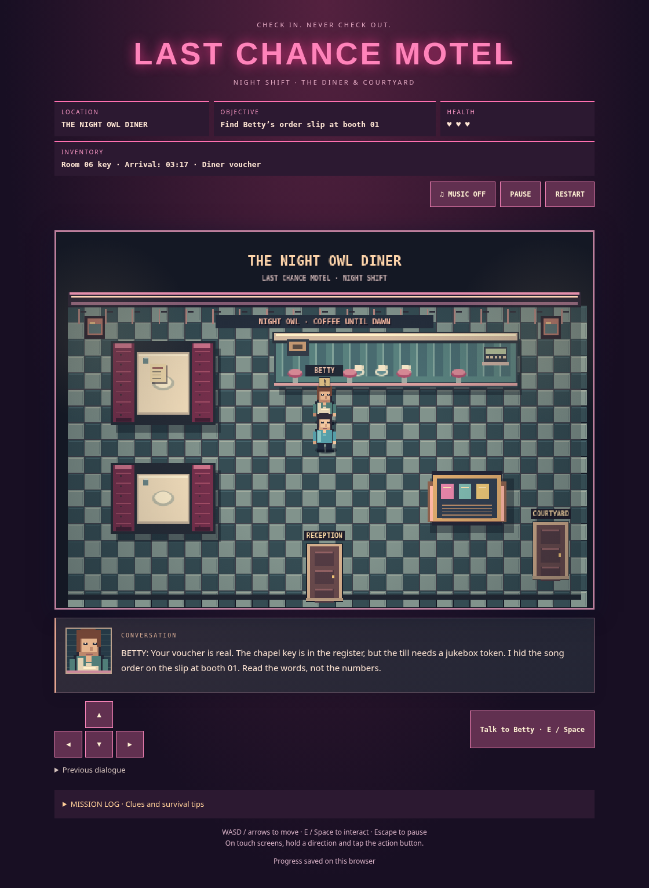

# Last Chance Motel — Night Shift

A browser-only survival-horror game with a complete check-in-to-escape route: office, parking lot, Room 06, diner, courtyard, chapel, car graveyard, optional garage, and a desert-road ending. The current game starts at **`index.html`**. The older HTML files under `source/` remain reference prototypes.

## Play locally

From the repository folder, run:

```sh
python3 -m http.server 8000
```

On the same computer, open `http://localhost:8000/`. Keep the terminal running. Use a server rather than opening `index.html` directly, because this version loads JavaScript modules. If port 8000 is occupied by a server for this folder, reuse it.

Move with WASD / arrows or hold the on-screen direction buttons. Press E / Space or tap the contextual action button near people and objects. Press **F** or tap the visible FLARE button to use an acquired flare. On phones, hold the on-screen directional pad and tap the action/flare buttons; no gestures or external keyboard are required. Music is opt-in. Escape or Pause freezes movement. Restart asks before clearing progress. Progress saves in this browser on this origin; changing the host or port uses a different save. If browser storage is unavailable, the game reports that progress lasts only for the session.

## Walkthrough (puzzle spoilers)

1. Walk up to Bobbi at the reception desk and interact to receive the Room 06 key.
2. Use the office’s right-hand PARKING door. Cross the exterior walkway to Room 06 and unlock it with your room key. Room 07 beside it stays locked throughout the game.
3. Read the registration slip on the central table. Note the arrival time, **03:17**.
4. Walk to the drawer at the right, interact, and enter **0317**. Collect the diner voucher.
5. Exit Room 06 to the parking lot. Cross to the OFFICE door at the lower right, then talk to Bobbi to hand over the voucher.

## Continue into the diner and courtyard

Existing saved progress is retained. If you already finished Room 06, show Bobbi the voucher, then use the office’s left-hand DINER door.

6. Talk to Betty at the diner counter. Read the order slip at booth 01 on the left.
7. Play **ROSE → MOON → SUN** on the jukebox at the lower right. A wrong sequence can be retried without a penalty.
8. Take the brass token to the register at the counter’s right end. Betty gives you the chapel key.
9. Use the courtyard door at the lower right. Harold patrols the right-hand path: his sight cone and status text warn you before he chases.
10. Use the laundry hiding place, keep the pool/hedges between you and Harold, and unlock the chapel gate. Retreating to the diner restores health. Losing all three hearts returns you there with your puzzle progress intact.

The mission log keeps discovered clues. Hiding stops movement; interact again to leave cover. Pause and dialogs freeze patrols. Enemy positions restart on scene entry or reload, while clues, keys, health and player position are saved.

## Chapel, graveyard and escape

11. Enter the chapel. Read the wedding score on the altar/lectern, then use the organ at the upper right. Play **G → C → C → C → G → D → B → C** to release the west-gate crank. Wrong phrases can be retried. The written score is available in the mission log; hearing the music is never required.
12. Leave the chapel and use the WEST GATE on the courtyard’s upper-left side. Speak to Casey near the graveyard entrance.
13. Search the tool locker in the **northwest** for the winch fuse. Fit it to the **east-side winch control**, then recover the Cadillac keys from the **northeast key box**.
14. The Monster patrols the wrecks and follows paths around solid obstacles. Watch its sight cone and warnings. The blue tarps at the north and south central gaps are hiding places. Keep moving when spotted and break line of sight.
15. **Optional garage:** read the service plate near the southeast wrecks, then enter the garage. The locker asks for your room number followed by your arrival minute: **0617**. It gives first aid and a single flare. Use FLARE in the graveyard to hold the Monster back for eight seconds. This detour is not required to finish.
16. Return through the west gate, retreat to the diner, pass through reception, and leave for the parking lot. Use the **pink Cadillac** to escape. **Taking the keys triggers a fast pursuit by both Harold and the Monster through every scene and door.** Run without stopping: hiding does not work during this escape, and the diner/chapel no longer restore health. A saved flare can hold both pursuers back for eight seconds, including indoors. Pause and open dialogs still freeze play. Room 07 stays locked even with the car keys.

Before taking the keys, getting caught shows a retry screen and returns you to the diner (Harold) or chapel (Monster), with health restored and every puzzle item retained. During the final pursuit, a catch returns you to the west courtyard gate with your car keys retained; the chase resumes on retry. Music/notes are opt-in; both puzzles can be solved silently. Reloading resumes progress, including the completed escape ending. Restart clears the current save only after confirmation.

This build has a complete playable route and win/retry flow. Automated playthroughs verify completion, not the design brief’s 15–25-minute first-play target. Human pacing, difficulty and likeness-specific art still need playtesting/art direction; the Monster is an original shadow design, not an actor likeness.

## Music

Enable **MUSIC** before or during play. In the chapel, the track changes to an original MIDI-style organ arrangement of Wagner’s public-domain **Bridal Chorus** (“Here Comes the Bride,” *Lohengrin*, 1850). Other areas use original synthesized themes, with a detection stinger and a MIDI-style arrangement of Mendelssohn’s public-domain **Wedding March** for the car outro. The active title appears below the music controls. No external audio files, recordings, browser plug-ins or MIDI player are required. See [audio credits](docs/AUDIO_CREDITS.md).

## Verify changes

No build or package installation is required to play. For automated checks:

```sh
node --test tests/*.test.mjs
# With the server above running, Python Playwright installed, and /usr/bin/chromium available:
python3 tests/night_shift_browser.py
python3 tests/diner_browser.py
python3 tests/presentation_browser.py
python3 tests/full_game_browser.py
python3 tests/checkpoint_browser.py
python3 tests/pursuit_browser.py
python3 tests/flare_keyboard_browser.py
python3 tests/audio_browser.py
```

The 30 logic tests cover progression gates, scene reachability, collision-safe navigation, storage migration, sightlines, hiding, damage, flares and checkpoints. The full-game browser test starts fresh, solves all puzzles, visits the optional garage, and reaches the saved ending with desktop keyboard and mobile on-screen controls. It accelerates the browser clock while exercising the real input and movement code; it does not establish human play time. The checkpoint test covers an actual Monster catch, retry, hiding and a successful escape without the garage or flare. Pursuit tests cover both enemies following indoors/across doors, faster speeds, shared damage cooldown, pause/reload continuity, flare persistence, and the direct `#watch` CTA. Audio checks render all five tracks through OfflineAudioContext and verify opt-in/mute behavior. Other browser checks cover layout, portraits, dialogue history, and the original chapter regressions. Screenshots are written under `/tmp/`.

## Publish the game

Upload `index.html` and the complete `source/night-shift/` directory together to a static web host, preserving their relative paths. No server-side code, build command, credentials, screenplay, or reference artwork is needed. Serve `.mjs` files as JavaScript (`text/javascript` or `application/javascript`). Test the hosted root page before sharing it. This repository has not been deployed automatically.

## Visual presentation

The current scenes use original procedural pixel art: patterned floor materials, wood grain, upholstered seating, shaded furniture, detailed vehicles, steady warm lighting, and face sprites with walking animation. The conversation card adds a speaker portrait. Full dialogue stays below the game canvas until the next conversation; Previous dialogue keeps the latest 16 lines for the current session. Persistent puzzle clues remain in the mission log after reload.



[Chapel](docs/screenshots/chapel.png) · [Car graveyard](docs/screenshots/graveyard.png) · [Escape ending](docs/screenshots/escape.png)

Presentation checks cover all eight explorable scenes at desktop/mobile sizes, portrait rendering, viewport overflow, conversation history, and dialogue remaining visible beyond the previous bubble timeout. Art rendering is separate from collision geometry and progression.

## Code layout

`source/night-shift/` contains separate modules for state/progression/save, scene definitions/collision, input, canvas rendering/dialogue, generated audio, and runtime/UI wiring. The art module draws scene materials, props, character sprites and portraits; the renderer composes the scene without painting labels over props. The finale module handles chapel/garage/escape progression; navigation is shared by collision-aware Monster AI and reachability checks. The enemy module handles patrol, detection, chase, damage and recovery. All game visuals are drawn locally with Canvas; no reference photos or screenplay text are bundled into the playable chapter.

---

## Original Codex handoff (historical reference)

The original repository was supplied as a handoff bundle. The following instructions describe that historical material; use the root `index.html` for the current game. It contains existing prototype source, the user-supplied annotated aerial map, user-supplied character reference images, the December 2024 screenplay, and implementation guidance.

## Quick start

1. Extract this ZIP into a local folder.
2. Open that folder as a project in Codex (or your editor connected to Codex).
3. Start with `docs/CODEX_TASK.md` and `docs/GAME_DESIGN_BRIEF.md`.
4. Open `source/last_chance_motel_v3.html` in a desktop browser to inspect the previous prototype. It may have rendering bugs; treat it as reference code, not production-ready.
5. Ask Codex to build the game iteratively, run a local dev server, use browser tests, and report test results honestly.

## Contents

- `source/`: V3 and V2 HTML game prototypes plus the original prototype.
- `references/`: character promotional art/reference photographs and annotated aerial property layout provided in chat.
- `screenplay/`: screenplay provided by user; contains major spoilers. Never expose major twists in public game.
- `docs/`: creative direction, development requirements, asset inventory, acceptance tests.

## Creative / rights notes

The supplied images and screenplay are for development reference. Confirm distribution rights and actor likeness permissions before shipping promotional imagery or likenesses publicly. Cadillac Jack's website photographs are NOT included; obtain permission before incorporating any original photographs. Create original pixel-art environments and sprites rather than redistributing external site assets.

Official film site for marketing CTA: https://lastchancemotelmovie.com/#watch . Verify destination and rental links before public launch.

## Local prototype checks

Serve the repository with Python 3:

```sh
python3 -m http.server 8000 --directory .
```

Open `source/last_chance_motel_v3.html` through that server. V3 is retained as a historical reference prototype. Use the root page for the current game.

With Python Playwright and Chromium installed at `/usr/bin/chromium`, run the browser regression check in another terminal:

```sh
python3 tests/v3_smoke.py
```

This checks desktop and mobile rendering, startup errors, desktop check-in, mobile control visibility, music toggling, and restart. It does not test a complete playthrough.
